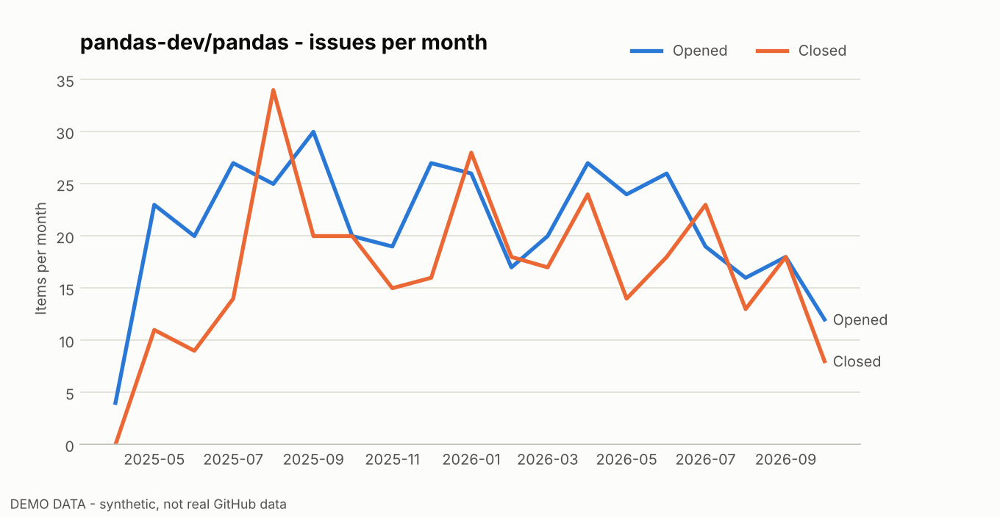
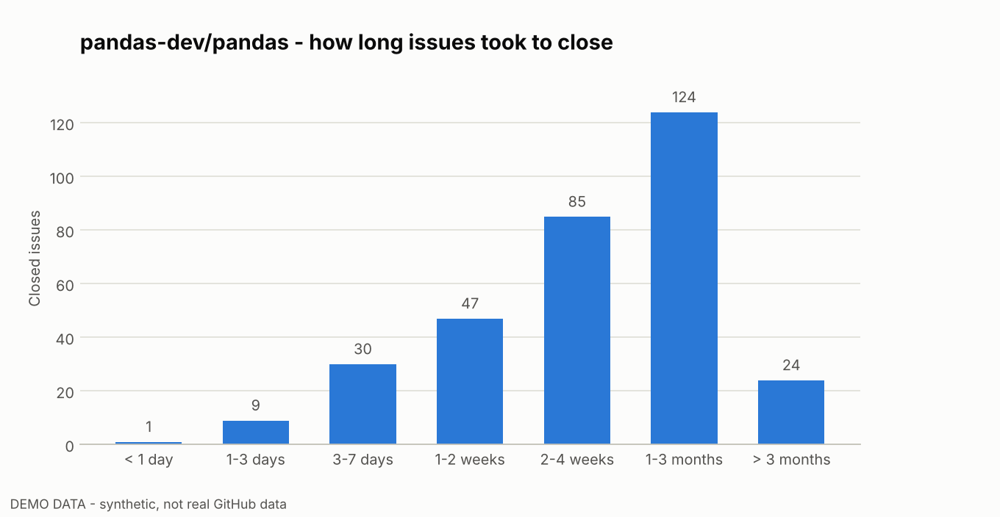
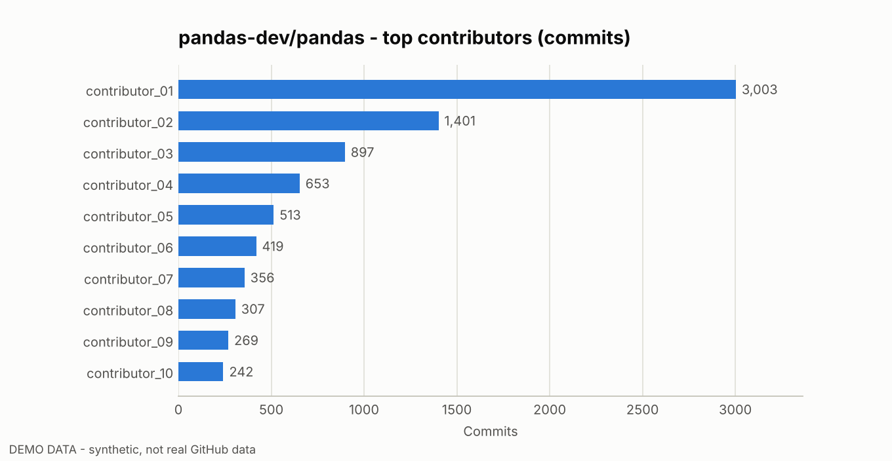
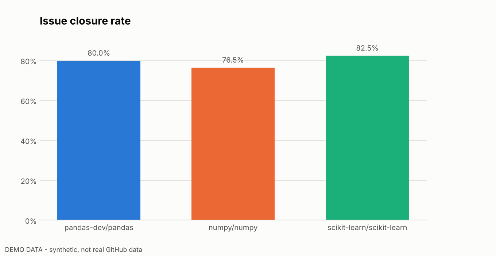

# OSS Insight BD

**Open-Source Software Intelligence Platform** - a Python data-science project that collects public GitHub repository data, cleans it with Pandas, and turns it into metrics and interactive charts.

`Python` `Pandas` `GitHub REST API` `Plotly` `Matplotlib` `Streamlit` `pytest`

> The screenshots below use **synthetic demo data** (labelled "DEMO DATA" in each image). Run the dashboard in *Live* mode to see real repositories.



## What it does

Pick up to three public GitHub repositories (for example `pandas-dev/pandas`) and get:

- **Overview** - stars, forks, open issues + PRs, language mix, repository age, last push.
- **Issues & PRs** - closure rate, median time to close/merge, monthly opened vs closed/merged, how long issues take to resolve.
- **Contributors** - top contributors and how concentrated the commits are (top-1 / top-5 / top-10 share).
- **Compare** - side-by-side metrics for up to three repositories.
- **Export** - download the cleaned data as CSV.

| How long issues take to close | Top contributors |
|---|---|
|  |  |



## Quick start

```bash
git clone https://github.com/Sohan-Rana/OSS-Insight-BD.git
cd OSS-Insight-BD

python -m venv .venv
# Windows:      .venv\Scripts\activate
# Mac / Linux:  source .venv/bin/activate

pip install -r requirements.txt
```

Optional but recommended - a GitHub token raises the API limit from 60 to 5000 requests/hour:

1. Create a token at GitHub -> Settings -> Developer settings -> Personal access tokens (no extra permissions are needed for public repositories).
2. Copy `.env.example` to `.env` and paste the token after `GITHUB_TOKEN=`.

`.env` is in `.gitignore`. Never commit it.

### Run the dashboard

```bash
streamlit run app.py
```

Choose **Live (GitHub API)** or **Demo data (offline)** in the sidebar, enter a repository, and press **Analyze**.

### Generate PNG charts from the command line

```bash
python generate_report.py pandas-dev/pandas                       # live data
python generate_report.py pandas-dev/pandas numpy/numpy --demo    # offline demo data
```

Charts are saved in `assets/` and a summary table in `data/exports/summary.csv`.

### Run the tests

```bash
pip install -r requirements-dev.txt
python -m pytest
```

The tests use a fake HTTP session, so they run without network access.

## How it works

```
GitHub REST API  ->  github_client.py   (pagination, 1-hour cache, rate-limit errors)
                 ->  analysis.py        (Pandas cleaning, monthly series, metrics)
                 ->  charts.py / report.py   (Plotly dashboard, Matplotlib PNGs)
                 ->  app.py / generate_report.py
```

```
OSS-Insight-BD/
├── app.py                  Streamlit dashboard
├── generate_report.py      CLI: PNG charts + CSV summary
├── ossinsight/
│   ├── github_client.py    API client
│   ├── analysis.py         cleaning + metrics
│   ├── pipeline.py         load one repository into a RepoBundle
│   ├── charts.py           interactive Plotly charts
│   ├── report.py           static Matplotlib charts
│   └── demo_data.py        synthetic offline data
├── tests/                  pytest suite
└── demo_*.png              demo screenshots
```

## Limitations (read before drawing conclusions)

- Issues and PRs are a **sample**: the newest *pages x 100* items. Older history is not included.
- *Time to close / merge* counts finished items only. Items still open are left out, so real waiting times are usually longer.
- Contributor shares use the top 100 contributors GitHub lists by commits.
- GitHub counts pull requests inside `open_issues_count`; this project separates them.
- Correlation is not causation. Many stars do not prove a project is well maintained.

## Research ideas

- Does contributor concentration relate to issue-resolution time?
- Do resolution times differ between projects of similar size?
- Which months show the most contribution activity?

To turn this into a study: define the question, choose repositories with a clear rule, collect a larger history (increase `--max-pages` or add date filtering), and report the limits above.

## Roadmap

- Date-range filtering and full-history collection
- Label-based analysis (bugs vs features)
- Statistical tests and confidence intervals
- Public deployment (Streamlit Community Cloud)
- **Live demo:** [oss-insight-bd.streamlit.app](https://oss-insight-bd-mheuahv72fcr674msbja3v.streamlit.app/)

## License

MIT - see [LICENSE](LICENSE).
